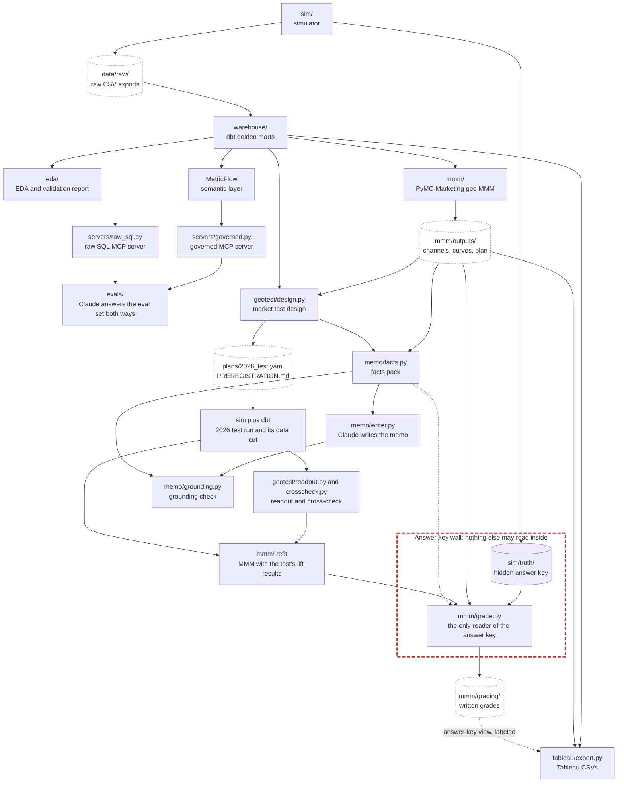

# Architecture

How data moves through the repo, from the fake world to the memo and the dashboards. Every box is a folder or a script you can open. `python -m stack.run` runs them in this order.

## What each box does

**The world**

- **sim/**: makes up Fernhook's world from a seed, with known true effects for every channel.
- **data/raw/**: the CSV files each source system would export, like ad platforms and the CRM.
- **sim/truth/**: the answer key, which holds the true effects the models try to find.

**The warehouse and Claude**

- **warehouse/**: dbt turns the raw files into tested golden tables that every later step reads.
- **eda/**: checks the golden tables for errors and gaps and writes a report.
- **MetricFlow semantic layer**: defines each metric once, so "paid media" or "CPA" means one thing.
- **servers/governed.py**: an MCP server that lets Claude ask only for those defined metrics.
- **servers/raw_sql.py**: an MCP server that gives Claude plain SQL on the raw files, as the baseline.
- **evals/**: asks Claude the same questions through both servers and scores the answers against SQL.

**The MMM and the wall**

- **mmm/**: fits a Bayesian geo MMM on the golden tables to estimate what each channel adds.
- **mmm/outputs/**: the model's results, like deals and cost per deal by channel and a budget plan.
- **mmm/grade.py**: compares the model's results to the answer key and is the only code allowed to read it.
- **mmm/grading/**: the written grades, which the memo never reads.

**The market test**

- **geotest/design.py**: uses the MMM and past data to design a test that can see the effect it expects.
- **plans/2026_test.yaml and PREREGISTRATION.md**: the test plan and its rules, written down before the test runs.
- **2026 test run**: the simulator runs the world on into 2026 with the test plan, and dbt builds that data.
- **geotest/readout.py and crosscheck.py**: read out the test by its own rules, then check it a second way.
- **mmm/ refit**: fits the MMM again with the test results added, and the grader scores it again.

**The memo**

- **memo/facts.py**: collects every number the memo may use into one facts pack, each tied to its source.
- **memo/writer.py**: Claude writes the memo from the facts pack and sees nothing else.
- **memo/grounding.py**: fails the memo if it holds any number the facts pack does not.

**The dashboards**

- **tableau/export.py**: writes the CSV files the Tableau dashboards are built on.

## The rules that hold it together

- Only `mmm/grade.py` reads `sim/truth/`. Tests check the source of every other folder for this.
- The memo reads `mmm/outputs/` and the test design. It never reads `mmm/grading/`.
- The Tableau answer-key view comes from the grader's written results, never from `sim/truth/`, and is labeled as the answer key.
- The test design and the readout come from data the team would have had at the time. No answer-key number goes into them.
