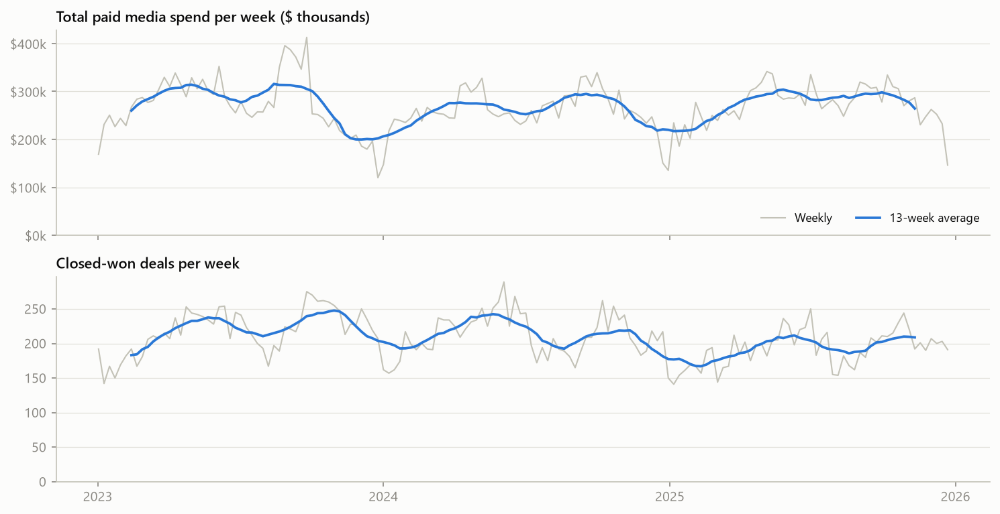
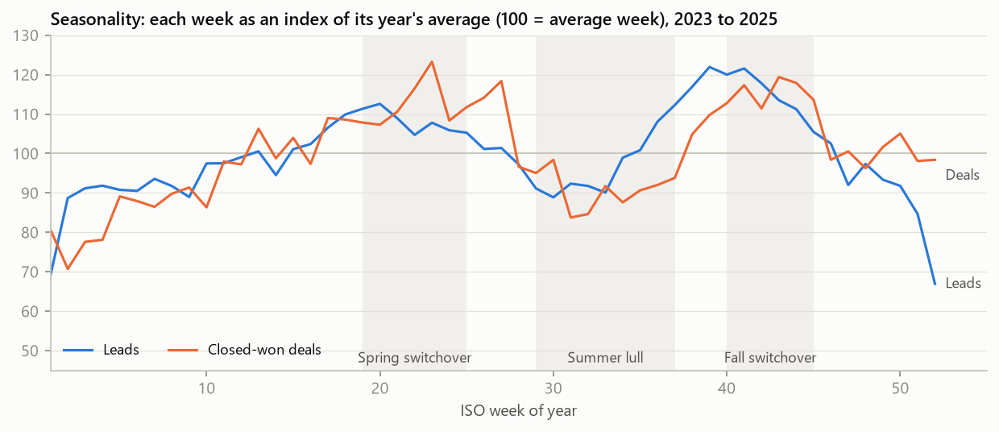
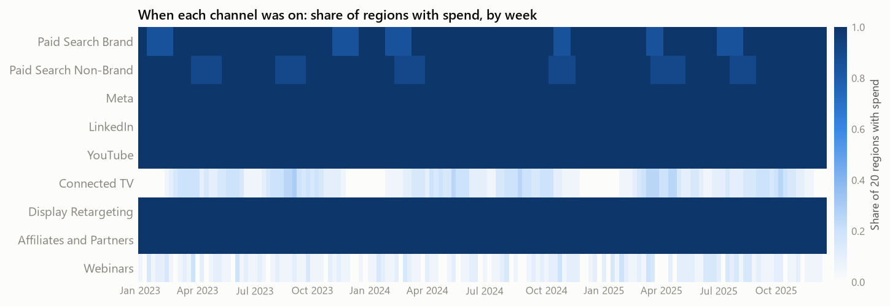
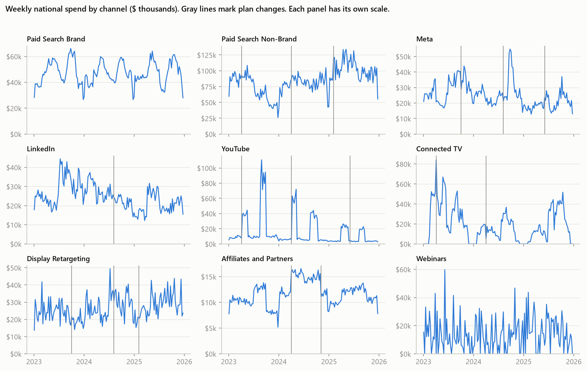
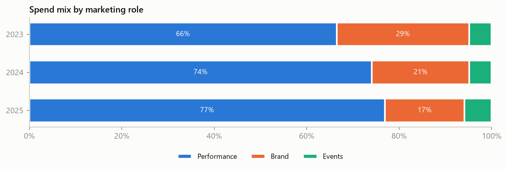
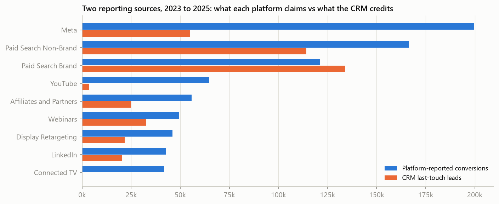
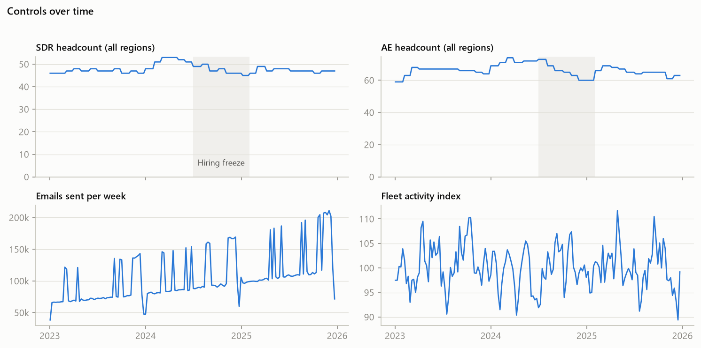

# EDA and data validation

Built by `python -m eda` from the dbt warehouse only: the golden tables plus a few staging views. Nothing here reads the simulator or its answer key, so this is what an analyst at Fernhook would see before an MMM.

## 1. Validation checks

10 of 10 checks pass; notes flag known limits. The dbt tests (`dbt build`) cover row-level rules; these are the checks an analyst reads before trusting the data.

| Check | Result | Status |
|---|---|---|
| Reporting window | 156 weeks, 2023-01-02 to 2025-12-22, 20 regions | Pass |
| fct_channel_weekly is a full grid | 28,080 rows (expected 28,080) | Pass |
| fct_funnel is a full grid | 40,560 rows (expected 40,560) | Pass |
| fct_controls_weekly is a full grid | 3,120 rows (expected 3,120) | Pass |
| Spend matches the platform exports | $41.9M in both; difference $0.00 | Pass |
| No negative values; clicks never exceed impressions | 0 bad rows | Pass |
| Every lead maps to a channel | 0 unmapped of 830,676; 19% recorded as direct | Pass |
| Lead to close (won deals) | median 14 days; 80% between 8 and 24 | Pass |
| Censoring at the end of the window | 41% of opportunities from the last 4 weeks are still open; treat the final weeks of deals as incomplete | Note |
| Promo and price calendar loaded | 4 entries | Pass |
| Channels are not collinear | largest correlation 0.51 (Meta and LinkedIn); largest VIF 2.0 | Pass |

## 2. Outcome and spend over time

| Year | Paid spend | Leads | Closed-won deals | New contract value | Spend per deal |
|---|---|---|---|---|---|
| 2023 | $14.2M | 241,602 | 11,365 | $31.0M | $1,249 |
| 2024 | $13.8M | 238,980 | 11,202 | $31.6M | $1,227 |
| 2025 | $13.9M | 229,039 | 9,842 | $29.4M | $1,414 |

The last few weeks of 2025 are undercounted for deals, because those leads have not had time to close.

## 3. Seasonality

Expected pattern for Midwest service fleets: busy when the season turns (AC switching on in late spring, heat switching on in late fall), a lull from mid-July into September, a soft winter, a deep holiday dip in late December and early January, and a smaller dip at Thanksgiving.

| Period | Expected | Leads index (100 = average week) | Holds |
|---|---|---|---|
| Holiday weeks (51, 52, 1) | well below 100 | 74 | Yes |
| Thanksgiving week (47) | below 100 | 92 | Yes |
| Winter after the holidays (weeks 3 to 9) | below 100 | 91 | Yes |
| Spring switchover, AC on (weeks 19 to 25) | above 100 | 108 | Yes |
| Summer lull into early fall (weeks 29 to 37) | below 100 | 97 | Yes |
| Fall switchover, heat on (weeks 40 to 45) | above 100 | 115 | Yes |

6 of 6 expectations hold. The data matches the planning calendar. During the year-end promo (weeks 46 to 50), deals run +5% relative to leads, which is what a discount on annual plans should do.

## 4. How the media was flighted

| Channel | Weeks on (of 156) | Regions used | Typical run in a region (weeks) | Typical pause (weeks) |
|---|---|---|---|---|
| Paid Search Brand | 156 | 20 | 88 | 6 |
| Paid Search Non-Brand | 156 | 20 | 92 | 7 |
| Meta | 156 | 20 | 156 | none |
| LinkedIn | 156 | 20 | 156 | none |
| YouTube | 156 | 20 | 156 | none |
| Connected TV | 129 | 8 | 8 | 16 |
| Display Retargeting | 156 | 20 | 156 | none |
| Affiliates and Partners | 156 | 20 | 156 | none |
| Webinars | 124 | 20 | 1 | 7 |

Media plan changes logged between annual plans:

| Date | Channel | Change | Reason |
|---|---|---|---|
| 2023-04-03 | Connected TV | +15% | Q1 review: CTV test expands, YouTube trimmed |
| 2023-04-03 | Paid Search Non-Brand | +7% | Q1 review: CTV test expands, YouTube trimmed |
| 2023-04-03 | YouTube | -22% | Q1 review: CTV test expands, YouTube trimmed |
| 2023-10-02 | Display Retargeting | +18% | Q4 plan: more retargeting for year-end |
| 2023-10-02 | Meta | -12% | Q4 plan: more retargeting for year-end |
| 2024-04-01 | Affiliates and Partners | +21% | Attribution review: video and CTV show few last-touch leads |
| 2024-04-01 | Connected TV | -34% | Attribution review: video and CTV show few last-touch leads |
| 2024-04-01 | Paid Search Non-Brand | +12% | Attribution review: video and CTV show few last-touch leads |
| 2024-04-01 | YouTube | -31% | Attribution review: video and CTV show few last-touch leads |
| 2024-08-05 | Display Retargeting | -15% | Cost cut during the hiring freeze |
| 2024-08-05 | LinkedIn | -19% | Cost cut during the hiring freeze |
| 2024-08-05 | Meta | -17% | Cost cut during the hiring freeze |
| 2024-11-04 | Affiliates and Partners | -24% | Two reseller contracts end |
| 2025-02-03 | Display Retargeting | +13% | New fiscal year: more for what last touch rewards |
| 2025-02-03 | Paid Search Non-Brand | +9% | New fiscal year: more for what last touch rewards |
| 2025-06-02 | Meta | +23% | Meta retest after a new creative agency |
| 2025-06-02 | YouTube | -14% | Meta retest after a new creative agency |

## 5. Spend mix

| Year | Performance | Brand | Events |
|---|---|---|---|
| 2023 | 66% | 29% | 5% |
| 2024 | 74% | 21% | 5% |
| 2025 | 77% | 17% | 6% |

## 6. Reporting sources disagree

Platforms claim 787,316 conversions in total; the CRM credits 405,762 leads to paid channels. Connected TV gets 0 last-touch leads because nobody clicks a TV ad. Neither source measures what a channel adds; that is the MMM's job.

## 7. Controls

- **Sales headcount** grows each Q1 hiring wave, then falls through the July 2024 to January 2025 freeze.
- **Email** volume grows with the list, with blasts in promo weeks.
- **Fleet activity index** moves a few points either way; it is the market-demand control.
- **Promo and price:** year-end discount weeks are flagged each year; list price rose 10% in July 2024 (index 1.10 after).

## 8. Channel by channel

What the data shows about how each channel was bought and reported. These are observations, not effects.

### Paid Search Brand

*Performance channel.* Bids on searches for Fernhook. Spend follows how many people search the brand. Twice a year a few markets pause it for a few weeks as a planned brand test.

- **When it ran:** On every week of the window; used in 20 of 20 regions, with about 19 active in a typical on-week. Always on within each region, apart from 18 regional pauses of about 6 weeks.
- **Spend:** 2023: $2.5M, 2024: $2.5M, 2025: $2.4M. Highest in Q2, lowest in Q1; the biggest week was 1.4 times a typical on-week. The top 5 regions take 52% of its spend and hold 50% of target accounts.
- **Plan changes:** none between annual plans.
- **Reporting:** the platform claims 121,092 conversions; the CRM credits 133,831 last-touch leads (0.9 times). Last-touch cost per lead: 2023: $51, 2024: $55, 2025: $60.
- **What to watch in the MMM:** its weekly spend tracks total leads closely (correlation 0.89). Spend that follows demand can look like it causes demand. The regional pauses are the cleanest evidence of what it adds.

### Paid Search Non-Brand

*Performance channel.* Always on. Budgets lean into busy seasons. Twice a year the team runs planned regional tests: a few markets pause and a few get extra budget.

- **When it ran:** On every week of the window; used in 20 of 20 regions, with about 19 active in a typical on-week. Always on within each region, apart from 12 regional pauses of about 7 weeks.
- **Spend:** 2023: $3.7M, 2024: $4.2M, 2025: $5.2M. Highest in Q2, lowest in Q4; the biggest week was 1.6 times a typical on-week. The top 5 regions take 50% of its spend and hold 47% of target accounts.
- **Plan changes:** Apr 2023 +7% (Q1 review: CTV test expands, YouTube trimmed); Apr 2024 +12% (Attribution review: video and CTV show few last-touch leads); Feb 2025 +9% (New fiscal year: more for what last touch rewards).
- **Reporting:** the platform claims 166,250 conversions; the CRM credits 114,175 last-touch leads (1.5 times). Last-touch cost per lead: 2023: $106, 2024: $109, 2025: $129.
- **What to watch in the MMM:** always on and seasonal (correlation with total leads 0.19), so most of its signal comes from the regional budget tests and pauses, not from week-to-week swings.

### Meta

*Brand channel.* Always-on prospecting that pushes before and into the spring and fall busy seasons and eases off in slow weeks. Each market's timing differs.

- **When it ran:** On every week of the window; used in 20 of 20 regions, with about 20 active in a typical on-week. Always on in every region it uses.
- **Spend:** 2023: $1.5M, 2024: $1.4M, 2025: $1.0M. Highest in Q3, lowest in Q2; the biggest week was 2.3 times a typical on-week. The top 5 regions take 55% of its spend and hold 47% of target accounts.
- **Plan changes:** Oct 2023 -12% (Q4 plan: more retargeting for year-end); Aug 2024 -17% (Cost cut during the hiring freeze); Jun 2025 +23% (Meta retest after a new creative agency).
- **Reporting:** the platform claims 199,719 conversions; the CRM credits 55,000 last-touch leads (3.6 times). Last-touch cost per lead: 2023: $73, 2024: $72, 2025: $67.
- **What to watch in the MMM:** pushes land on the busy seasons, so spend rises when demand does. Each market's push comes on its own week and at its own size, and that is the contrast to learn from; the June 2025 retest adds a late step up.

### LinkedIn

*Performance channel.* Lead-gen forms, always on. Market budgets are re-split every quarter.

- **When it ran:** On every week of the window; used in 20 of 20 regions, with about 20 active in a typical on-week. Always on in every region it uses.
- **Spend:** 2023: $1.5M, 2024: $1.3M, 2025: $1.0M. Highest in Q3, lowest in Q4; the biggest week was 1.9 times a typical on-week. The top 5 regions take 56% of its spend and hold 48% of target accounts.
- **Plan changes:** Aug 2024 -19% (Cost cut during the hiring freeze).
- **Reporting:** the platform claims 42,632 conversions; the CRM credits 20,427 last-touch leads (2.1 times). Last-touch cost per lead: 2023: $195, 2024: $191, 2025: $177.
- **What to watch in the MMM:** always on with no pauses, so its signal comes from quarterly market re-splits and plan changes.

### YouTube

*Brand channel.* National flights that run several weeks ahead of each busy season, with a low level in between. Each flight targets about three in four markets.

- **When it ran:** On every week of the window; used in 20 of 20 regions, with about 20 active in a typical on-week. Always on in every region it uses.
- **Spend:** 2023: $1.1M, 2024: $0.8M, 2025: $0.4M. Highest in Q3, lowest in Q1; the biggest week was 15.3 times a typical on-week. The top 5 regions take 52% of its spend and hold 50% of target accounts.
- **Plan changes:** Apr 2023 -22% (Q1 review: CTV test expands, YouTube trimmed); Apr 2024 -31% (Attribution review: video and CTV show few last-touch leads); Jun 2025 -14% (Meta retest after a new creative agency).
- **Reporting:** the platform claims 64,631 conversions; the CRM credits 3,376 last-touch leads (19.1 times). Last-touch cost per lead: 2023: $712, 2024: $686, 2025: $767.
- **What to watch in the MMM:** flights are national and run ahead of each busy season, so they line up with the run-up in demand; long carryover means effects can land in the busy weeks after a flight ends.

### Connected TV

*Brand channel.* A market test in 8 markets. Each runs its own flight ahead of each busy season and goes dark between flights.

- **When it ran:** On 129 of 156 weeks nationally; used in 8 of 20 regions, with about 3 active in a typical on-week. Within a region it typically runs 8 weeks on, then pauses for 16 weeks (40 regional pauses in all).
- **Spend:** 2023: $1.4M, 2024: $0.7M, 2025: $0.9M. Highest in Q3, lowest in Q4; the biggest week was 4.4 times a typical on-week. The top 5 regions take 82% of its spend and hold 36% of target accounts.
- **Plan changes:** Apr 2023 +15% (Q1 review: CTV test expands, YouTube trimmed); Apr 2024 -34% (Attribution review: video and CTV show few last-touch leads).
- **Reporting:** the platform claims 41,662 conversions; the CRM credits 0 last-touch leads (with no CRM credit to compare against). Last-touch cost per lead: not defined (no CRM credit).
- **What to watch in the MMM:** runs in only 8 regions. The other 12 regions are a natural comparison group, and each test market times its own flights.

### Display Retargeting

*Performance channel.* Always-on retargeting of past site visitors. Market budgets are re-split every quarter.

- **When it ran:** On every week of the window; used in 20 of 20 regions, with about 20 active in a typical on-week. Always on in every region it uses.
- **Spend:** 2023: $1.2M, 2024: $1.5M, 2025: $1.5M. Highest in Q3, lowest in Q1; the biggest week was 1.9 times a typical on-week. The top 5 regions take 54% of its spend and hold 47% of target accounts.
- **Plan changes:** Oct 2023 +18% (Q4 plan: more retargeting for year-end); Aug 2024 -15% (Cost cut during the hiring freeze); Feb 2025 +13% (New fiscal year: more for what last touch rewards).
- **Reporting:** the platform claims 46,095 conversions; the CRM credits 21,618 last-touch leads (2.1 times). Last-touch cost per lead: 2023: $164, 2024: $201, 2025: $209.
- **What to watch in the MMM:** always on and retargets people who already visited, so it overlaps with demand from every other channel.

### Affiliates and Partners

*Performance channel.* Placement and sponsor fees with local resellers and fleet consultants, set when each market's contracts renew every quarter. Commissions are booked as cost of sale.

- **When it ran:** On every week of the window; used in 20 of 20 regions, with about 20 active in a typical on-week. Always on in every region it uses.
- **Spend:** 2023: $0.5M, 2024: $0.7M, 2025: $0.6M. Highest in Q3, lowest in Q4; the biggest week was 1.4 times a typical on-week. The top 5 regions take 51% of its spend and hold 46% of target accounts.
- **Plan changes:** Apr 2024 +21% (Attribution review: video and CTV show few last-touch leads); Nov 2024 -24% (Two reseller contracts end).
- **Reporting:** the platform claims 55,830 conversions; the CRM credits 24,726 last-touch leads (2.3 times). Last-touch cost per lead: 2023: $70, 2024: $80, 2025: $71.
- **What to watch in the MMM:** fees change only when each market's contracts renew, so there are few distinct spend levels to learn from, and the top 5 regions take 51% of spend against 46% of accounts.

### Webinars

*Events channel.* Regional live events. Cost lands in the week of each event.

- **When it ran:** On 124 of 156 weeks nationally; used in 20 of 20 regions, with about 2 active in a typical on-week. Spend comes in single weeks; a region typically goes 7 weeks between them.
- **Spend:** 2023: $0.7M, 2024: $0.7M, 2025: $0.8M. Highest in Q1, lowest in Q4; the biggest week was 4.2 times a typical on-week. The top 5 regions take 53% of its spend and hold 50% of target accounts.
- **Plan changes:** none between annual plans.
- **Reporting:** the platform claims 49,405 conversions; the CRM credits 32,609 last-touch leads (1.5 times). Last-touch cost per lead: 2023: $68, 2024: $65, 2025: $66.
- **What to watch in the MMM:** spend lands in one region and one week at a time, a strong natural experiment.

## 9. Strongest spend correlations

| Channel A | Channel B | Correlation |
|---|---|---|
| Meta | LinkedIn | 0.51 |
| Paid Search Non-Brand | Meta | -0.40 |
| Paid Search Brand | YouTube | 0.40 |
| Paid Search Brand | Connected TV | 0.35 |
| Paid Search Non-Brand | LinkedIn | -0.35 |

Variance inflation (VIF) of national weekly spend: Meta 2.0, Paid Search Non-Brand 1.9, Paid Search Brand 1.7, LinkedIn 1.5, YouTube 1.5, Affiliates and Partners 1.4, Display Retargeting 1.3, Connected TV 1.2, Webinars 1.1.
