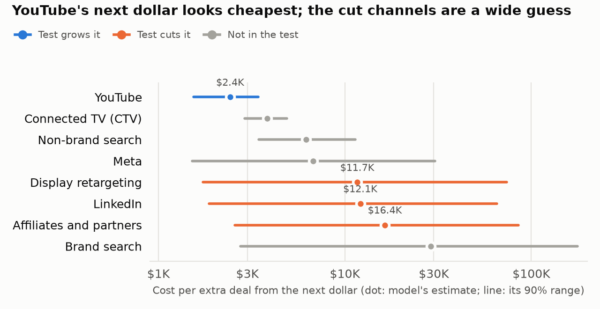

# Chapter 3: the proposal memo (January 2026)

An agent turns the MMM's outputs and the pre-registered market test into a one-page proposal for the CFO, and a script fails the run if the memo holds any number the facts pack does not.

**The memo ([proposal_memo.md](outputs/proposal_memo.md)):** "Approve a spring market test now for $97K net, and decide the rollout in late May." It runs as a story: the problem, what we found, the ask, what it's worth, how we'll know. One number in the headline, point estimates only in the body, every range in an appendix, and one chart. All 32 numbers match the facts pack.



**What changed from the first memo.** The first draft (step 5) asked for a free 8-week test of the cuts in 4 markets. That test could only see a drop about 6.6 times what the model expected, so it could not do its job. This memo asks for the test in [`geotest/PREREGISTRATION.md`](../geotest/PREREGISTRATION.md): YouTube pushed far above plan in 10 markets and the cut channels dark in a crossing 10, sized by placebo tests on 2023 to 2025 data. It costs $97K net and gives the YouTube side an 81% chance of seeing the lift the model expects.

| Variant | Memo claims, extra deals a year (90% range) | True | Covered |
|---|---:|---:|---|
| Same-budget reallocation | 166 (10 to 334) | 194 | yes |
| YouTube +50% (new money) | 128 (75 to 172) | 221 | no |

The table is the grader's check of the plan the memo describes ([MMM grade](../mmm/grading/grade_holdout.md)), not something the memo or the test design saw. The memo now asks for the test, not the reallocation, so the reallocation's number sits in its appendix and the YouTube +50% variant is no longer stated.

## Three parts and a chart

```
mmm/outputs/  ----------+
                        +->  memo/facts.py  ->  facts.json  ->  memo/writer.py (claude -p)  ->  proposal_memo.md
geotest/outputs/design.json                        |   \                                          |
                                                   |    +-> memo/chart.py -> proposal_chart.png   |
                                                   +---------------> memo/grounding.py <----------+
                                                                            |
                                                                      grounding.json (fails below 100%)
```

1. **Facts pack** (`memo/facts.py`, plain Python): reads `mmm/outputs/` and the test design (`geotest/outputs/design.json`), and writes [`facts.json`](outputs/facts.json): 127 facts, each with an id, value, unit, kind and source file. Same inputs, same bytes.
2. **Chart** (`memo/chart.py`): cost per extra deal by channel with the 90% range, drawn from `facts.json` only. The channel the test grows is blue, the channels it cuts are orange (a palette validated for color-blind readers), and the rest are gray.
3. **Writer** (`memo/writer.py`): headless `claude -p`, default model `claude-sonnet-5-5`. Every built-in tool is off, no MCP servers load, and it runs from an empty folder, so the facts pack in the prompt is all it sees.
4. **Grounding check** (`memo/grounding.py`): pulls every number from the memo and matches it to a fact under the rules below. It writes [`grounding.json`](outputs/grounding.json) and exits 1 below 100%.

**Executive form, checked by script** (`writer.style_problems`): a `#` headline with at most 3 numbers; sections The problem, What we found, The ask, What it's worth, How we'll know, Appendix: the ranges; the one chart line at the end of What we found; no range and no "90% range" wording above the appendix; 230 to 400 words and at most 16 numbers above it; no dashes. If grounding or style fails, the writer gets the failures and rewrites, up to `--retries` times. This run needed 4 drafts: the first 3 ran 435 to 440 words. [`writer.json`](outputs/writer.json) logs every attempt, about $0.23 each.

## Run it

From the repo root, after the MMM has written `mmm/outputs/` and `python -m geotest.design` has written the design (no warehouse needed):

```bash
.venv\Scripts\python -m memo --retries 3
.venv\Scripts\python -m memo.grounding
.venv-mmm\Scripts\python -m mmm.grade
.venv\Scripts\python -m pytest tests/test_memo.py -q
```

- `python -m memo` builds the facts and the chart, writes the memo, checks it, and exits 1 unless grounding is at 100% and the style checks pass. `--model` and `--retries` change the writer.
- `python -m memo.facts`, `python -m memo.chart` and `python -m memo.grounding` run one part. The grounding check takes `--memo`, `--facts` and `--out`.
- `mmm.grade` reads the memo's outputs when they exist and adds the truth check to `mmm/grading/`.
- The memo code is plain Python, so it runs in either environment. It needs the Claude CLI signed in.

## The facts pack

**A year** is the average year of the MMM window: 156 weeks, or 3 years at 2023 to 2025 spend. The MMM scores whole-window spend paths, so each per-year fact is the window number divided by 3. That is exact for means and for 90% ranges, because it rescales every posterior draw the same way.

**Point estimates:** deal changes use posterior means, because the optimizer maximizes the mean and means add up. Channel CPAs and deals use medians, as the MMM docs do.

**Kinds:** `estimate` (an MMM output), `input` (spend or observed deals), `derived` (arithmetic on outputs, written out in the fact's `how`), `design` (the pre-registered test).

| Group | What | From |
|---|---|---|
| The problem | 2024 and 2025 won deals, paid spend and blended cost per deal, and their changes, from the December 2025 data cut | `geotest/outputs/design.json` |
| Model context | Markets, window, paid spend, observed deals, blended CPA, holdout error | `channels.json`, `diagnostics_holdout.json` |
| Paid media | Deals it causes, its incremental CPA and share of deals, each with a 90% range | `channels.json` summary |
| Every channel | Spend, deals, CPA and marginal CPA with 90% ranges. Meta, YouTube and CTV include deals they create through brand search | `channels.json` |
| Revenue per deal | $2,841: the MMM values each deal at its market's average won-deal revenue | `channels.json` |
| Reallocation | The optimizer's plan at the same total: each channel's move, extra deals and revenue with ranges, odds of a gain, extra brand-search spend, payback | `optimizer.json` |
| YouTube +50% | New money on the lowest cost per extra deal, up to the optimizer's limit, kept for the grader | `optimizer.json`, `response_curves_total.csv` |
| Risks | Wide ranges, always-on channels not measured, Meta mixed with the season, paid media likely under-credited, a good fit is not proof, YouTube past what the model has seen | `docs/mmm/README.md`, numbers from outputs |
| The test | Markets, weeks, the YouTube step, its spend, the cuts' saving, the net cost, the MMM's forecast for each side with its range, the smallest lift each side can see, its power, and the shorter test that falls short | `geotest/outputs/design.json` |

**Payback** is months of first-year revenue from the extra deals needed to repay the extra spend. It uses revenue, not margin, because the MMM has no cost of goods. The reallocation adds no budget, so its only new cost is the $69K a year of brand search that follows the extra searches.

**Derived ranges.** Revenue, payback and cost per extra deal map the deal range through a fixed formula. Each holds the same 90% of draws as the deal range, but it is not always the narrowest such range.

**Prose carries no numbers.** The risks, test and recommendation text in the pack hold no digits or number words (a test checks this), so the writer cannot pass along an unchecked number. The test dates are month-day dates, which grounding exempts.

## Grounding rules

**What counts as a number:** dollars ($2,841, $1.5M, $472K, 2 million dollars), percents (5.4%, 30 percent), multipliers (1.5x), counts (166 deals, 4 markets), durations (8 weeks, an 8-week test, 12 months), ranges (10 to 334, $29K to $948K, 6-8 weeks, between 6 and 8), and number words (two to ninety, hundred, thousand, million, billion, dozen, zero, half, double, twice, triple).

**Exempt:** years (a bare 1990 to 2099 with no comma, $, % or scale), ISO dates (2025-12-22), month-day dates (June 1), section and list numbering at the start of a line, digits glued to letters (Q1, B2B), ordinals (3rd), and the word "one".

**Units must agree.** `$` or "dollars" matches only USD facts, `%` only percent facts, `x` only multipliers. A count or duration takes the unit of the next word (deals, markets, channels, weeks, months, years), skipping filler like "more" or "extra". A bare number with no unit word may match any fact that is not USD or percent.

**Rounding.** A number matches a fact when the fact, rounded to the digits the memo shows, equals it, and the memo keeps at least two significant figures.

| Fact | Passes | Fails |
|---|---|---|
| 1,491,623 USD | $1.5M, $1.49M, $1,491,623 | $1M, $2M, $1.4M |
| 472,478 USD | $472K, $470K, $0.47M | $473K |
| 166.3 deals | 166, 170, 166.3 | 200 |
| 8 weeks | 8 weeks, an 8-week test, eight weeks | 9 weeks, 8%, $8 |

Trailing zeros in a whole number are not significant ($500K means $495K to $505K). Signs are ignored, because the words carry the direction: "cut $540K" matches a -540,098 fact.

**Ranges** must match one fact's own low and high, in either order. Ends from two facts fail. A single number may match a fact's value, low or high.

## What grounding does not check

- **Meaning.** It checks that each number exists in the pack with the right unit, not that the sentence uses it correctly.
- **Bare numbers** match any count-type fact by value. In this memo, "clearly above zero" counts "zero" as a number, and it matches a fact whose range ends at 0.
- **Words without digits.** "Far above plan" or "only a guardrail" are claims, not numbers. The writer's prompt and the pack's prose keep them tied to the design, but no script checks them.

## Boundaries

- `memo/` reads `mmm/outputs/`, `geotest/outputs/design.json` and its own outputs, nothing else. It never reads the answer key in `sim/` or the MMM's grading folder. Tests check the source text and record every file the facts pack, the chart and the grounding check open.
- Everything the memo uses is from before the test: the MMM fit on 2023 to 2025, and a test design built from the December 2025 data cut.
- `mmm/grade.py` stays the only reader of the answer key. `grade_memo` reads `memo/outputs/facts.json` for each variant's channel multipliers and claimed range, runs the moves through the true, noise-free response curves, and reports whether the claimed range covered the true gain and whether the memo stated it.

## Tests

`tests/test_memo.py`, 72 tests, about a second:

- An invented number fails grounding: added dollars, deals, months, percents and number words, and one changed digit.
- Allowed rounding passes, and wrong rounding, too few significant figures and wrong units fail.
- A range passes only on one fact's own ends.
- Dates, years, numbering and labels are exempt.
- The style check catches a range above the appendix and a headline with too many numbers.
- The chart plots only facts, and reads only `facts.json`.
- `memo/` never reads the answer key or grading output.
- The facts pack is deterministic and equals the committed file.
- The committed memo passes grounding and style, and matches the committed `grounding.json`.

## Limits

- **The memo can be only as right as the MMM.** Its YouTube cost per extra deal is the model's; the test exists to check it.
- **The cut side of the test is weak.** It sees the cuts only if they cost 2.7 times what the model expects. The memo says so in plain words.
- **One sample.** The memo is one draw from the writer. Wording changes run to run, and grounding and the style check are the only gates.

## Disclosures

- The step 5 memo's grade (the table above, and its notes in git history) showed that its 8-week test would miss the cuts' true cost. The new test design was built with that grade in the repo. No answer-key number enters the design or the memo: every design number comes from 2023 to 2025 marts and the MMM's posterior (`geotest/design.py`), and tests check that `geotest/` and `memo/` never read the answer key.
- The step 5 disclosures still hold: the first truth check printed each channel's true deal change under the plan, and fixes after it touched parsing and wording only.
