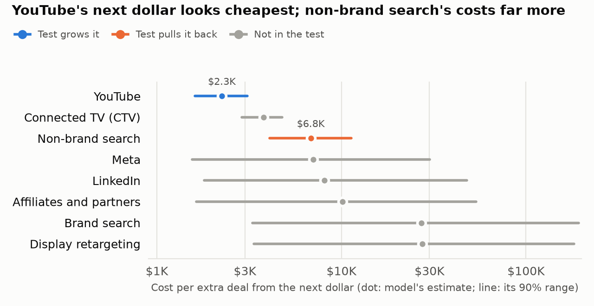

# Approve the spring market test now; it needs no new money

## The problem
Paid spend rose every year, and most of the new money went to non-brand search ($3.4M in 2023, $8.4M in 2025). The mix moved from mostly balanced to mostly performance: 60% of spend in 2023, 80% in 2025.

Deals fell 12% in 2025 and cost per deal climbed 31%. We cannot say whether the extra search money still works.

## What we found
The model rates YouTube best for the next dollar: $2,250 per extra deal, against $6,830 for non-brand search. Its plan keeps the budget flat, growing YouTube, connected TV and Meta, and trimming non-brand search, LinkedIn, display and affiliates.

What the model cannot see:
- Non-brand search, LinkedIn, display and affiliates never pause, so the data never show life without them. Every cut lands there.
- Meta's effect cannot be told from the busy season.
- Paid media is likely under-credited, so the cuts may cost more.

## The ask
Approve the spring market test now. Decide the rollout after the readout.

The test runs 12 weeks, February 2 to April 26. One group of markets gets YouTube well above plan, a level the model has never seen. A crossing group pulls non-brand search back to its 2023 pace. Each is measured against markets outside it.

Net, it spends $342K less than plan: pulling search back saves more than the YouTube push costs.

## What it's worth
If the model is right, the plan adds 218 deals a year and $621K in extra revenue, on the same budget. Testing first protects the budget: the cuts are the least certain part.

## How we'll know
- YouTube works if its lift is clearly positive.
- If pulling search back costs clearly more deals than the model expects, the rollout will not cut search below today's spend.
- Either way, both results feed a refit model, and the rollout follows it.

Readout: late May, after late deals close.

Limits: the YouTube group has 81% odds of seeing the lift if the model is right. The search group is a guardrail, with 45% odds of seeing the drop. YouTube runs beyond our data, so that forecast is a stretch.

## Appendix: the ranges
Every range here is a 90% range: the model gives 90% odds the true value is inside.
- Plan, extra deals a year: 218 (121 to 311)
- Plan, extra revenue a year: $621K ($345K to $885K)
- Cost per extra deal, YouTube: $2,250 ($1,610 to $3,100)
- Cost per extra deal, non-brand search: $6,830 ($4,090 to $11,300)
- Share of all deals that paid media causes: 35% (27% to 45%)
- Test, extra deals from the YouTube push: 119 (88 to 154)
- Test, deals lost from pulling search back: -83 (-120 to -41)
