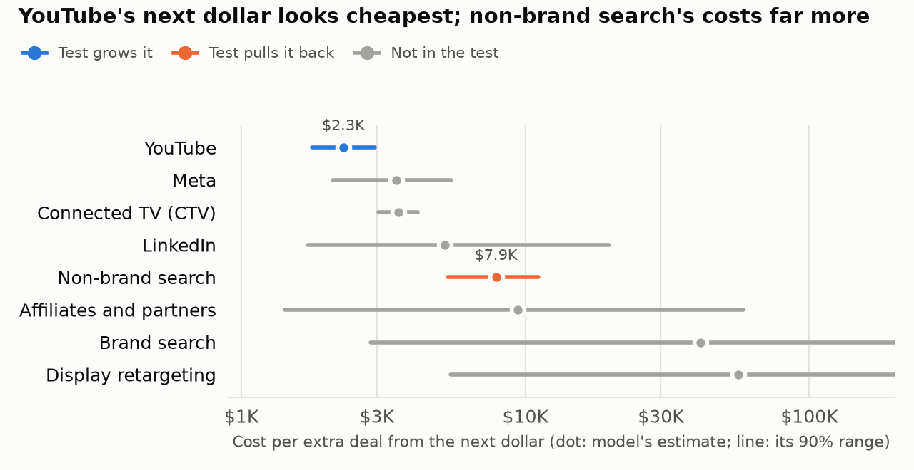

# Approve the spring market test now; it needs no new money

## The problem

Spend rose every year, mostly into non-brand search, and the mix moved from mostly balanced to mostly performance (60% of spend in 2023, 80% in 2025).

Deals then fell 10% and cost per deal rose 29%. We cannot say whether the extra search money still works.

## What we found

The model says the next dollar works best on YouTube, at $2,290 per extra deal. In non-brand search it costs $7,900.

Its flat-budget plan moves money from non-brand search, display retargeting and affiliates to YouTube, Meta, connected TV and LinkedIn. If the model is right, it adds about 890 deals a year.

What it cannot see:

- Always-on channels never pause, so the data never show life without them. Every cut lands there.
- Meta moves with the busy seasons, so its effect blends in.
- Paid media is likely under-credited, so cuts may cost more than shown.
- A good fit on total deals does not prove the split by channel.

## The ask

Approve the spring market test now, starting February 2. Decide the rollout after the readout, not before.

The test runs 12 weeks: YouTube well above plan in one group of markets, non-brand search at an earlier, lower pace in another.

Net cost: the test spends $1.1M less than plan, because pulling search back saves more than the extra YouTube costs.

## What it's worth

If the model is right, the plan adds about $2.5M in first-year revenue a year. Testing first protects the budget: the cuts fall where the model sees least.

## How we'll know

Rules set before the test:

- YouTube works if its lift is clearly positive.
- If pulling search back costs clearly more deals than the model expects, we do not cut search below today's spend.
- Either way, the model is refit and the rollout follows it.

The readout comes in late May.

Limits: the YouTube group has 81% odds of seeing the lift if the model is right. The search group is only a guardrail (35% odds), so a quiet result does not prove cutting is safe. YouTube also runs past any level in our data, so that forecast is a stretch.

## Appendix: the ranges

Every range below is a 90% range: the model gives 90% odds the true value is inside.

- Extra deals a year from the plan: 888 (577 to 1,230).
- Extra first-year revenue a year from the plan: $2.5M ($1.6M to $3.5M).
- Months for that revenue to cover the extra brand-search spend: 1.0 (0.72 to 1.5).
- Cost per extra deal, YouTube: $2,290 ($1,770 to $2,950).
- Cost per extra deal, non-brand search: $7,900 ($5,320 to $11,100).
- Share of all deals that paid media causes: 30% (24% to 36%).
- Test, extra deals from the YouTube push: 334 (287 to 382).
- Test, deals lost from pulling search back: 190 (113 to 252).
- Smallest effects the test can reliably see: 328 deals for YouTube, 376 deals for pulling search back.
