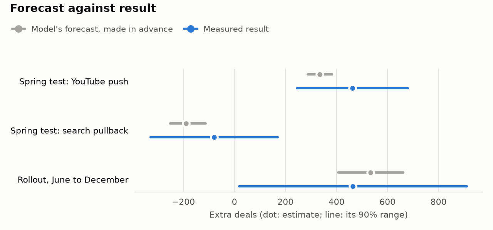

# The rollout worked: a clear gain in deals at the same budget

## What we did

In spring we ran a 12-week test in matched markets. One group pushed YouTube. The other pulled back non-brand search. YouTube worked. Search showed no clear drop. Neither safety check tripped, so the rollout followed the refit model, as written down before the test.

From June we ran the model's plan in 15 markets at the same total budget. We put more into Meta, YouTube, connected TV, LinkedIn and affiliates. We put less into display retargeting and non-brand search. We kept 5 markets on the old plan all year so we could measure the rollout against them.

## What happened

Deals rose 11% on the year before. Paid spend fell 1.8%. Cost per deal fell 11%.

These totals hold everything that moved in 2026: the spring test, the rollout, sales headcount, the market and the season. They describe the year. They do not measure the rollout. The holdout does.

## Did it work

Spring test: YouTube worked. It produced 463 extra deals against a model forecast of 334. That is above the forecast but inside the model's range, so it agrees with the model. Pulling search back showed no clear drop. That side had low odds of seeing the drop the model expected, so it does not show search does nothing. It only rules out a big hidden loss.

Rollout: it worked, and the whole measured range is a gain. The rollout markets won 464 extra deals against the holdout. The model had forecast 533, so the result agrees with the forecast. The holdout had 63% odds of a clear read at the forecast lift. The model's own view of the rollout is a cross-check and decides nothing.

## What it cost

The rollout stayed inside the budget. It moved $2.1M between channels and added no new spend except the brand search that follows extra searches. That brand search came to $91K.

From June to December, cost per deal ran a little higher in the rollout markets ($1,490) than in the holdout markets ($1,440). We do not read that gap as a verdict on the plan. The measured lift is the test.

## What's next

- Keep the rollout plan into the new year. Refit the model on the full year with the holdout result added.
- Keep a smaller holdout running. A holdout this size can only see a large effect.
- Test non-brand search again with a bigger and longer pullback. It is still the biggest and least measured channel.
- Hold Meta flat in a few markets through a busy season, so the model can tell Meta from the season.

## Appendix: the ranges

Every range below is a 90% range.

- YouTube push, measured extra deals: 463 (246 to 679).
- YouTube push, model forecast: 334 (287 to 382).
- YouTube push, cost per extra deal, counting the brand search that followed: $1,390 ($946 to $2,620).
- Search pullback, measured deal change: 79 lost (from a loss of 328 to a gain of 170).
- Search pullback, model forecast: 190 lost (from a loss of 252 to a loss of 113).
- Rollout, measured extra deals against the holdout: 464 (18 to 911).
- Rollout, model forecast: 533 (407 to 661).
- Rollout, the model's own view of the realized result: 505 (383 to 633).
